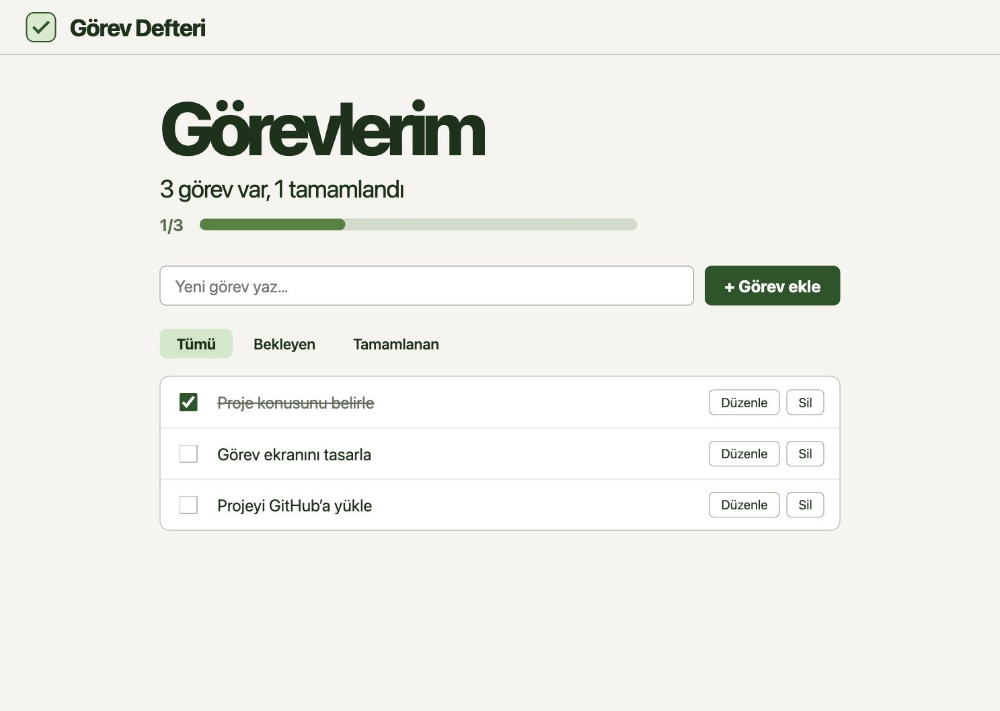

# Görev Defteri

JavaScript Web Geliştirme projesi için React, Vite ve düz CSS ile hazırlanmış görev takip uygulaması. Görevler aynı tarayıcıda `localStorage` ile saklanır.

## Çalıştırma

Node.js 20.19+ veya 22.12+ gerekir.

```bash
npm ci
npm run dev
```

Terminalin gösterdiği yerel adresi tarayıcıda aç.

## Uygulamayı deneme

1. Görev adını yaz ve **Görev ekle** düğmesine bas.
2. Yeni kaydı görev listesinde bul.
3. **Düzenle** ile adını değiştir veya onay kutusuyla tamamlandı olarak işaretle.
4. Sayfayı yenile ve değişikliğin korunduğunu kontrol et.
5. **Sil** ile kaydı kaldır.

## Yayınlama

`npm run build` komutu yayın dosyalarını `dist` klasöründe oluşturur. Netlify'da GitHub deposunu içe aktar. Projedeki `netlify.toml` derleme komutunu ve yayın klasörünü tanımlar.

## Kod yapısı

- `src/App.jsx` görev listesini, ekleme formunu ve filtreleri yönetir.
- `src/components/TaskRow.jsx` görev satırını ve satır içi düzenlemeyi gösterir.
- `src/tasks.js` örnek görevleri ve tarayıcıdan yükleme işlemini içerir.

## Ekran görüntüsü


